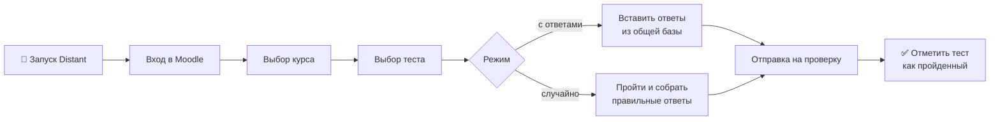

# 🎓 Distant Console

**Автоматическое прохождение тестов на Moodle — платформа «ирбис-дистант».**

[Что это](#-что-это) • [Возможности](#-возможности) • [Как работает](#-как-это-работает) • [Установка](#-установка) • [Использование](#-использование) • [FAQ](#-faq)

---

## 📖 Что это

**Distant Console** — программа для автоматического заполнения и сдачи тестов на платформе
[ирбис-дистант.рф](https://xn----8sbbnrbc5bumdmc.xn--p1ai/my/index.php).

Работает полностью автоматически: выбирает курс, открывает тест, заполняет ответы и отправляет на проверку.
Два режима прохождения: **с ответами** (из общей базы) и **случайно** (собирает правильные ответы для следующих раз).

> [!IMPORTANT]
> Начиная с версии **2.0** у программы полностью новый консольный интерфейс: скруглённые карточки,
> выбор стрелками, поиск, тонкая полоса загрузки и счётчик заданий.

---

## ✨ Возможности

- 🎯 **Два режима**: «с ответами» — берёт готовые из общей базы; «случайно» — проходит и собирает правильные.
- 📚 **Выбор курса и теста** прямо в консоли: список, поиск, номера уроков.
- ✅ **Автоотметка**: пройденный тест автоматически помечается как выполненный.
- 🏆 **Оценки на виду**: у пройденных тестов видно лучший балл, а после прохождения — результат попытки.
- 💾 **Общая база ответов**: правильные ответы сохраняются и помогают другим.
- 🖥 **Новый интерфейс**: карточки, стрелки, поиск, индикатор загрузки и счётчик заданий `3/10`.
- 🔄 **Проверка обновлений** при запуске — можно обновиться прямо из программы.
- 🌐 **Все типы заданий**: текст, выбор, перетаскивание, порядок, выделение слов, сопоставление.

---

## ⚙️ Как это работает

1. Программа открывает браузер Chromium и входит в личный кабинет.
2. Ты выбираешь курс → тест → режим прохождения.
3. Скрипт сам заполняет задания и отправляет тест.
4. Правильные ответы уходят в общую базу, задание помечается пройденным.

> [!TIP]
> Режим **«случайно»** удобен для пополнения базы: программа проходит тест и запоминает верные ответы,
> чтобы в следующий раз пройти его «с ответами» за секунды.

---

## 📦 Требования

| Компонент | Назначение |
| :--- | :--- |
| **Windows 10/11** | программа собрана под Windows |
| **Google Chrome / Microsoft Edge** | используется установленный браузер |
| **Интернет** | вход в личный кабинет и синхронизация ответов |
| **Код приглашения** | выдаётся автором, привязывается к ПК |

> Если Chrome/Edge не установлены — программа автоматически скачает Chromium при первом запуске
> (первый запуск займёт больше времени).

---

## 🚀 Установка

**1. Скачай** `Distant.exe` со страницы [**Releases**](https://github.com/NOTyeamu/Distant-Console-Public/releases/latest).

**2. Положи в любую папку** и запусти.

**3. При первом запуске** потребуется:

- логин и пароль от ирбис-дистант;
- **код приглашения** (получить можно на почту ниже).

<b>Как обновиться</b>

 

Программа сама проверяет обновления при запуске и предложит установить новую версию —
можно установить прямо в папку или открыть страницу релизов. Обновление можно пропустить,
но напоминание будет появляться при каждом запуске.

---

## 🕹 Использование

**1.** Запусти `Distant.exe`.
**2.** Введи логин и пароль от ирбис-дистант.
**3.** Введи код приглашения (при первом запуске).
**4.** Выбери режим работы: **упрощённый** (рекомендуется) или **расширенный** (с подробным выводом).
**5.** Выбери **курс** → **тест** → **режим прохождения**.
**6.** Программа заполнит и отправит тест автоматически.

| Режим | Что делает |
| :--- | :--- |
| **С ответами** | вставляет готовые ответы из общей базы и отправляет |
| **Случайно** | проходит тест, собирает правильные ответы и сохраняет их |

---

## ❓ FAQ

<b>Не удалось активировать / не подходит код</b>

 

Код **одноразовый** и привязывается к конкретному ПК. Если код уже использован на другом
устройстве — напиши на почту ниже, чтобы получить новый.

<b>Ошибка «Не удалось подключиться»</b>

 

Проверь интернет. Иногда мешают VPN и антивирус — добавь `Distant.exe` в исключения
и попробуй снова.

<b>Тест не проходит / задания не заполняются</b>

 

Убедись, что выбрана актуальная версия программы. Если ответы для теста ещё не собраны —
попробуй режим **«Случайно»**, он соберёт правильные ответы для следующего раза.

<b>Долго проходит тест</b>

 

Скорость зависит от числа заданий и скорости сайта. В расширенном режиме виден подробный
вывод и счётчик заданий `3/10`.

---

## 📝 Заметки

- Программа заточена под Windows и платформу «ирбис-дистант».
- Исходный код и полная история изменений — в приватном репозитории автора.
- Актуальная версия всегда на странице [Releases](https://github.com/NOTyeamu/Distant-Console-Public/releases).

## 📬 Контакты

По любым вопросам, багам, предложениям и за **кодом приглашения**:

**contact.yeamu@gmail.com**

---

Спасибо, что пользуетесь Distant ❤️

